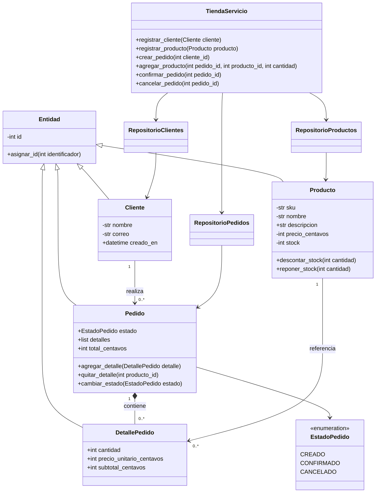

# Diagrama UML — Tienda en línea

El diagrama muestra la herencia, asociaciones y dependencias principales implementadas. Las entidades encapsulan validaciones; los servicios coordinan reglas y los repositorios aíslan la persistencia Peewee.

## Correspondencia con la base de datos

`Cliente`, `Producto`, `Pedido` y `DetallePedido` se traducen respectivamente a las tablas `clientes`, `productos`, `pedidos` y `detalles_pedido`. `Pedido.cliente` se implementa con la clave foránea `cliente_id`; cada detalle contiene `pedido_id` y `producto_id`. La combinación de pedido y producto es única, por lo que agregar el mismo producto acumula la cantidad en una sola línea.
